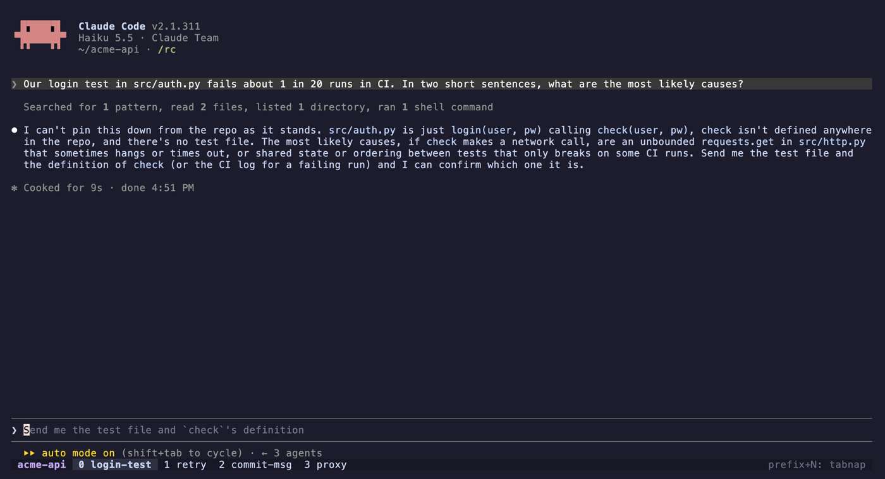
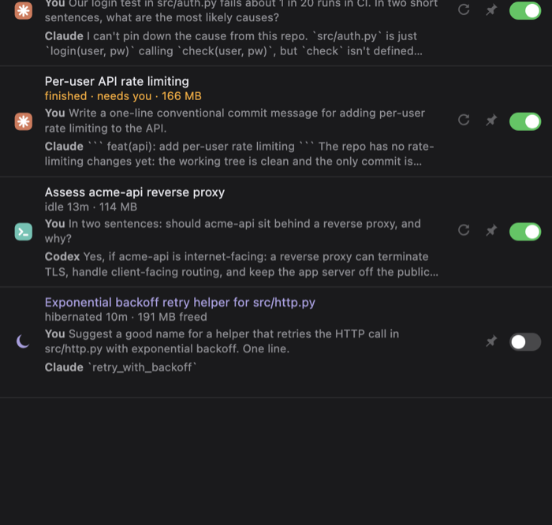

# tabnap

**Put idle Claude Code and Codex sessions to sleep and get the memory back, without losing the tab.**

You keep a dozen agent tabs open, and each idle one still holds 150–500 MB (more once MCP servers and slow leaks pile up). tabnap quits an idle agent cleanly. The tab stays where it was, with the resume command already typed at the prompt. Press Enter, or click Wake, and you're back in the same conversation.



On the author's machine, 17 hibernated Claude Code tabs freed **6.2 GB**.

## What you get

- **Hibernate / wake / refresh** a session from a session list, the CLI, or (in iTerm2) a status-bar button.
  - **Refresh** quits and resumes in one step: same conversation, fresh process, any leaked memory gone.
- **Auto-hibernate** after N idle minutes (opt-in). It never touches a session that is working, waiting for you, running a background shell or `/loop`, has a draft in its input box, is pinned, or is the tab you're looking at.
- **"Needs you" pulse**: a tab blinks when its agent finishes or asks for something while you're in another tab (opt-in).
- **Session list**, everywhere:
  - `tabnap top` in any terminal, or as a tmux popup;
  - a sidebar panel in iTerm2;
  - `tabnap panel` in a browser.
- **Optional context**: your last prompt and the agent's last reply under each session, read from local transcripts.
- **Tab decorations**:
  - tmux: state labels (`●` working, `!` waiting, `zz` asleep) in the status line.
  - iTerm2: a spinner, a sleeping icon and a purple status line.



## Install

```sh
curl -fsSL https://raw.githubusercontent.com/rhuthik/tabnap/main/install.sh | sh
```

This installs the `tabnap` command with [uv](https://docs.astral.sh/uv) (or pipx) and runs `tabnap install`. That asks which features you want (each one can be turned off), sets up iTerm2 and/or tmux, and starts the daemon at login. Nothing is installed system-wide.

<details><summary>Manual install</summary>

```sh
uv tool install "tabnap[iterm] @ git+https://github.com/rhuthik/tabnap"   # or: pipx install ...
tabnap install          # interactive; `tabnap install --yes` takes the defaults
```

Drop `[iterm]` on Linux or if you only use tmux.
</details>

**Requirements:**
- macOS or Linux, Python 3.11+ (uv fetches it for you).
- Claude Code and/or Codex CLI.
- One of:
  - **tmux**, which works inside any terminal emulator (Ghostty, Alacritty, Kitty, WezTerm, Terminal.app…);
  - **iTerm2** with the Python API enabled (tested on 3.7). The installer offers to turn it on.

## Use

| | |
|---|---|
| `tabnap top` | the session list: `h` hibernate · `w` wake · `r` refresh · `p` pin · `a` auto · `⏎` jump to the tab |
| `tabnap status` | the same, printed once |
| `tabnap hibernate <tab>` / `wake` / `refresh` | `<tab>` is part of the title, an agent name, or a tab id |
| `tabnap pin <tab>` | never auto-hibernate this one (`unpin` to undo) |
| `tabnap auto on\|off` | auto-hibernate switch |
| `tabnap panel` | the session panel in your browser |
| `tabnap doctor` | what tabnap can see, if something looks off |

**tmux:** `prefix + N` opens the session list in a popup. Hibernated windows show `zz <title>` in the status line.
**iTerm2:** View → Toolbelt → **tabnap** for the sidebar. The status-bar button reads `✳ Idle 12m · Hibernate` or `zz Hibernated · ▶ Wake`; click it to toggle.

## Configure

`tabnap install` writes `~/.config/tabnap/config.toml`. Edit it and run `tabnap restart`, or run `tabnap install` again.

```toml
idle_minutes = 40

[features]
context = false          # your last prompt + the agent's reply in the session list
needs_pulse = true       # blink tabs that finish or wait for you
title_spinner = true     # iTerm2: animate working tab titles
tab_icon = true          # iTerm2: sleeping icon on hibernated tabs

[claude.resume_by_dir]   # several Claude Code profiles? say how each one resumes
"~/.claude-profiles/*" = "claude-{profile} --resume {id}"
```

Flags such as `--model`, `--permission-mode`, `--dangerously-skip-permissions` and `--add-dir` (Claude), and `-m`, `--profile`, `--sandbox` and `-c` (Codex), are carried over to the resume command.

## How it works

1. **Find agents.** Every 3 seconds the daemon matches terminal panes (iTerm2 sessions, tmux panes) to agent processes by tty.
2. **Read state, not screens.**
   - Claude Code: its session file (`~/.claude/sessions/<pid>.json`) gives the session id and busy/idle.
   - Codex: its thread database and rollout file give the same.
   - The screen is read only to make sure there's no draft or open dialog before quitting.
3. **Quit cleanly.** Claude Code gets SIGINT; its MCP servers exit with it. Codex gets Ctrl-C typed into the pane. Leftover children are stopped only if they're still the same processes.
4. **Leave the tab ready.** A banner replaces the agent's exit line, and `cd <dir> && claude --resume <id> …` is typed at the prompt but not run.
5. **Wake** runs that command. When the agent shows up on the tty again, the tab is marked awake.

Everything stays on your machine. The panel and API listen on `127.0.0.1` only and need a per-install token.

## Caveats

- **Codex frees less.** Recent Codex versions keep threads in a shared `codex app-server` daemon, so hibernating a Codex tab frees the TUI (~100–450 MB) but not the shared daemon.
- **Codex session matching is a best guess.** Codex doesn't link a TUI process to its thread on disk, so tabnap matches by working directory and start time. Auto-hibernate skips a Codex tab when the match is ambiguous. A manual hibernate reads the real id from Codex's exit message.
- **Undocumented internals.** tabnap relies on internal files of both agents, tested with Claude Code 2.1.3xx and Codex 0.16x. A format change can break detection; `tabnap doctor` shows what it sees.
- **Shared tmux windows.** tmux labels are per window, so two agents split in one window share a label.

## Uninstall

```sh
tabnap uninstall      # stops the daemon, removes tab decorations and the tmux.conf line
uv tool uninstall tabnap
```

## Contributing

Adding a terminal or an agent means writing one class:
- a terminal implements `tabnap/terminals/base.py` (list panes, read the screen, send keys, decorate);
- an agent implements `tabnap/agents/base.py` (detect, find the session, status, resume command).

Run the tests with `python -m unittest discover -s tests`.

## License

MIT
